# Revêtements routiers à liants biosourcés : aide à la décision SIG

Outil SIG et analyse multicritère pour identifier où, et avec quel revêtement biosourcé, renouveler la voirie de Lyon. Il intègre des tests de robustesse et une prospective 2030-2050.

**Voir en ligne :** [accueil](https://jauresmas.github.io/voirie-bas-carbone-lyon/) · [version grand public](https://jauresmas.github.io/voirie-bas-carbone-lyon/grand-public/) · [version pour spécialistes](https://jauresmas.github.io/voirie-bas-carbone-lyon/webmap/)

Le projet comprend deux cartes web :
- une carte d'analyse pour les spécialistes, qui présente la méthode pas à pas ;
- une version grand public pour les habitants.

> **Étude de recherche, pas un programme de travaux.** Les propriétés des revêtements sont des hypothèses de travail et le calendrier des chantiers est simulé. Aucune décision de la Métropole de Lyon n'est associée à ces résultats.

## Aperçu

**Version grand public** : récit en six stations, recherche de sa rue, Lyon en 2050.

<p align="center">
  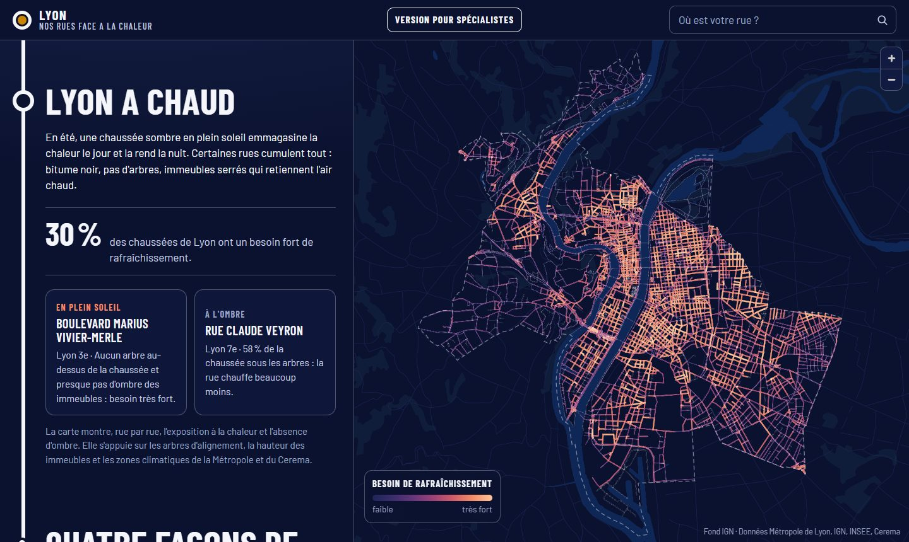
  &nbsp;
  
</p>

**Version pour spécialistes** : planche de figures, de la donnée à la prospective.

<p align="center">
  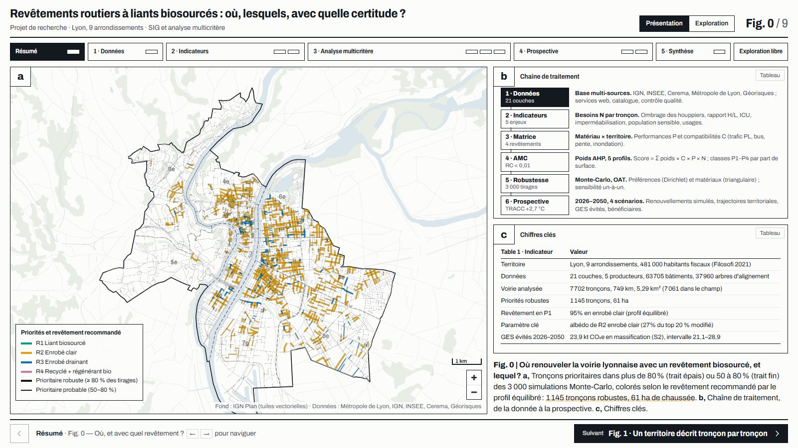
  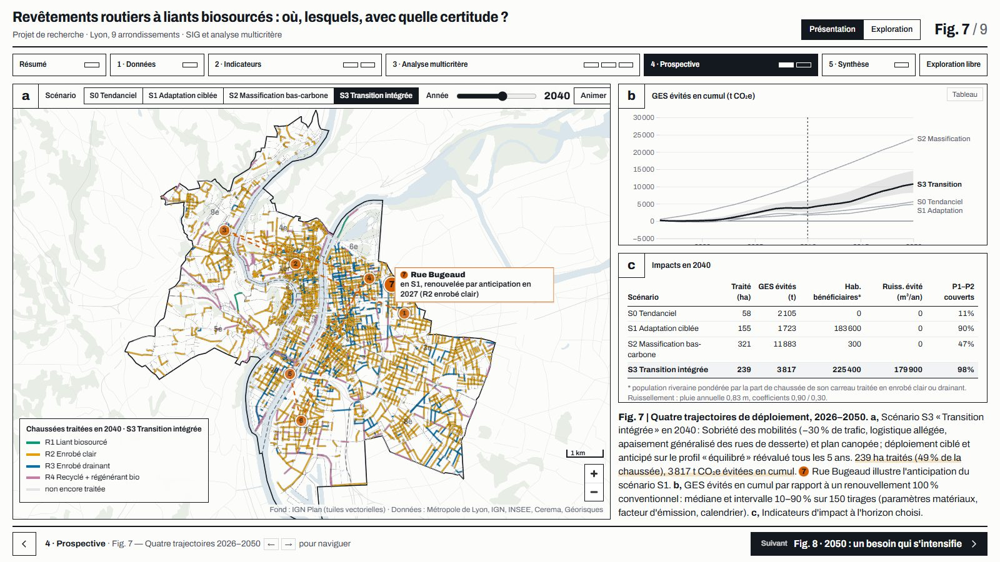
</p>

**Cartes A4** (projet QGIS, `05_valorisation/cartes/`) : cliquer sur une carte pour l'agrandir.

<table>
<tr><td align="center" width="50%"><a href="05_valorisation/cartes/carte1_trafic_pl.png">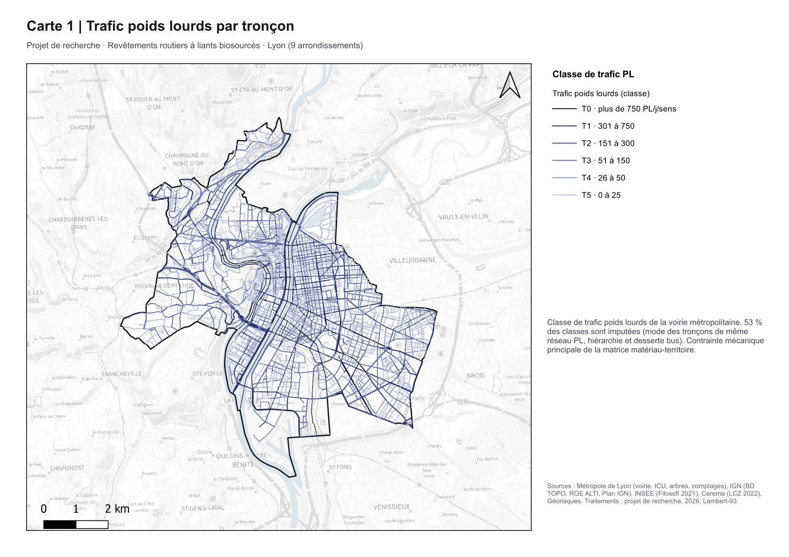</a><br><sub>1. Trafic poids lourds par tronçon</sub></td><td align="center" width="50%"><a href="05_valorisation/cartes/carte2_besoin_chaleur.png">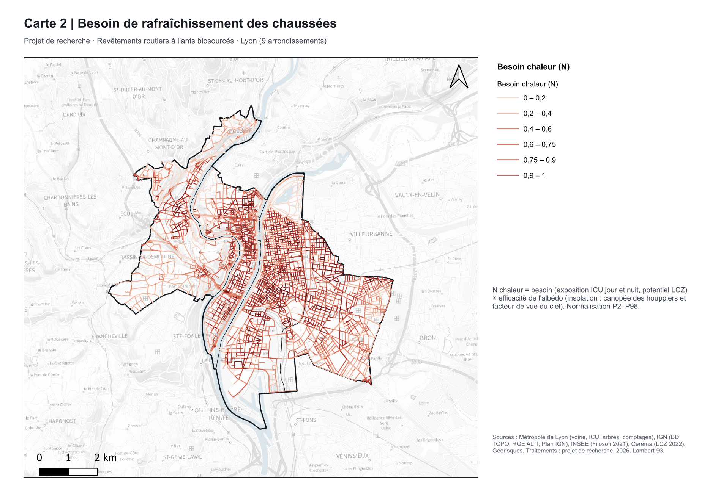</a><br><sub>2. Besoin de rafraîchissement</sub></td></tr>
<tr><td align="center" width="50%"><a href="05_valorisation/cartes/carte3_aptitude_R3.png">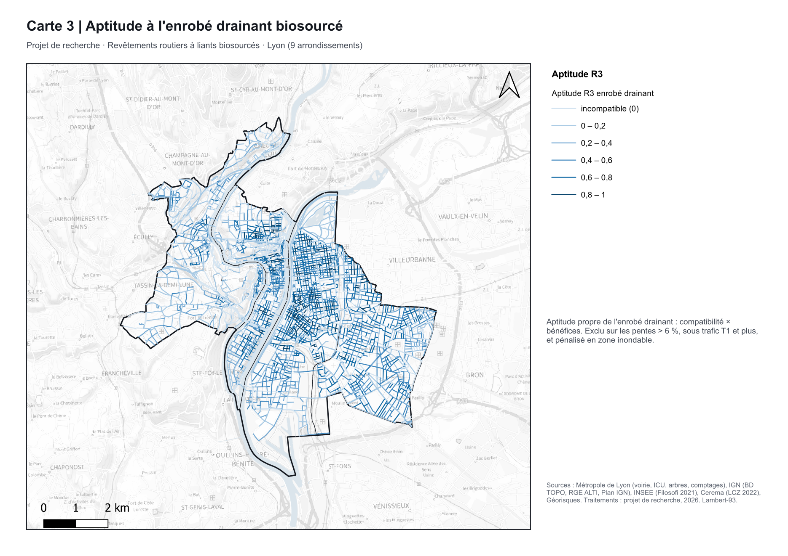</a><br><sub>3. Aptitude à l'enrobé drainant</sub></td><td align="center" width="50%"><a href="05_valorisation/cartes/carte4_priorites_equilibre.png">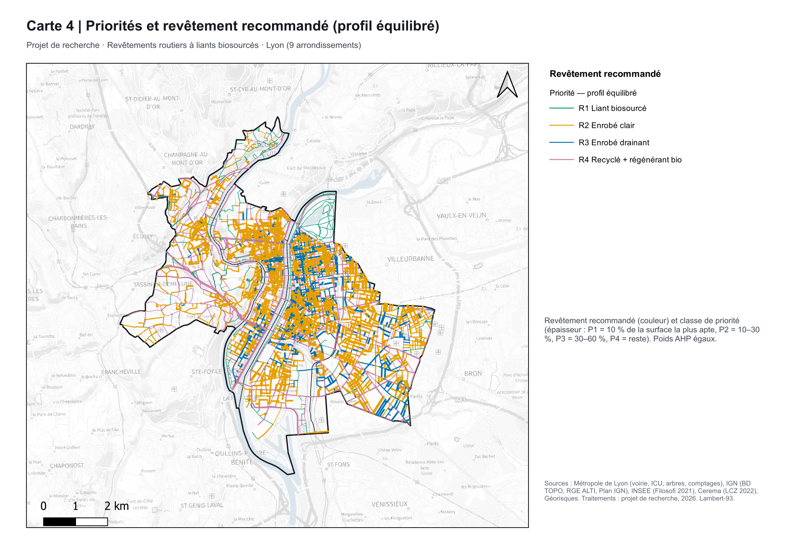</a><br><sub>4. Priorités et revêtement recommandé</sub></td></tr>
<tr><td align="center" width="50%"><a href="05_valorisation/cartes/carte5_robustesse.png">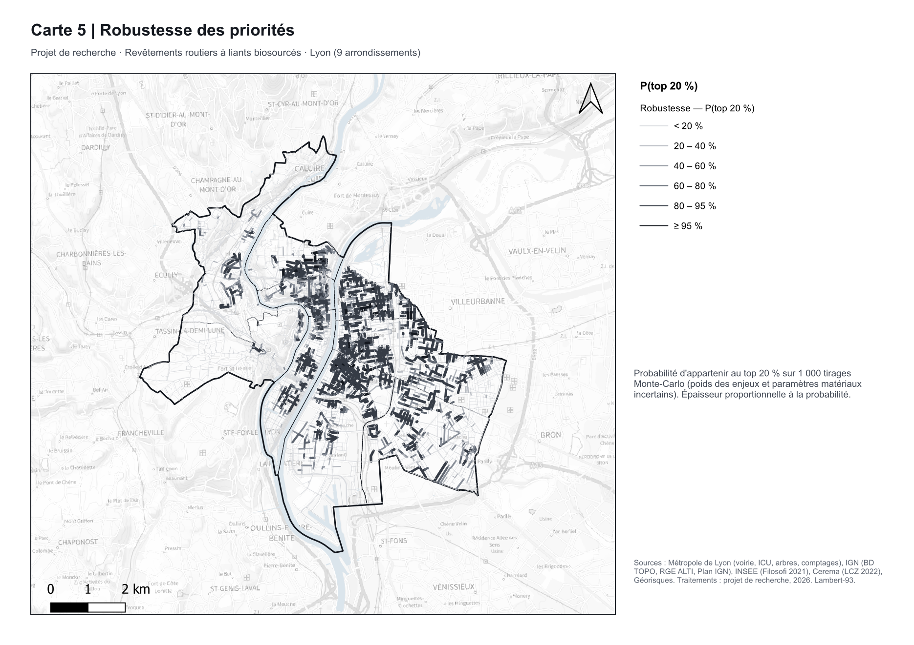</a><br><sub>5. Robustesse des priorités</sub></td><td align="center" width="50%"><a href="05_valorisation/cartes/carte6_prospective_S3_2040.png">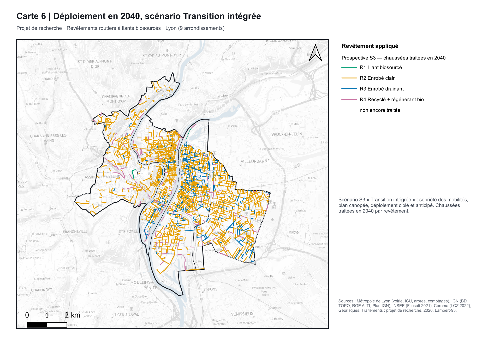</a><br><sub>6. Déploiement en 2040 (transition)</sub></td></tr>
<tr><td align="center" width="50%"><a href="05_valorisation/cartes/carte7_evolution_2050.png">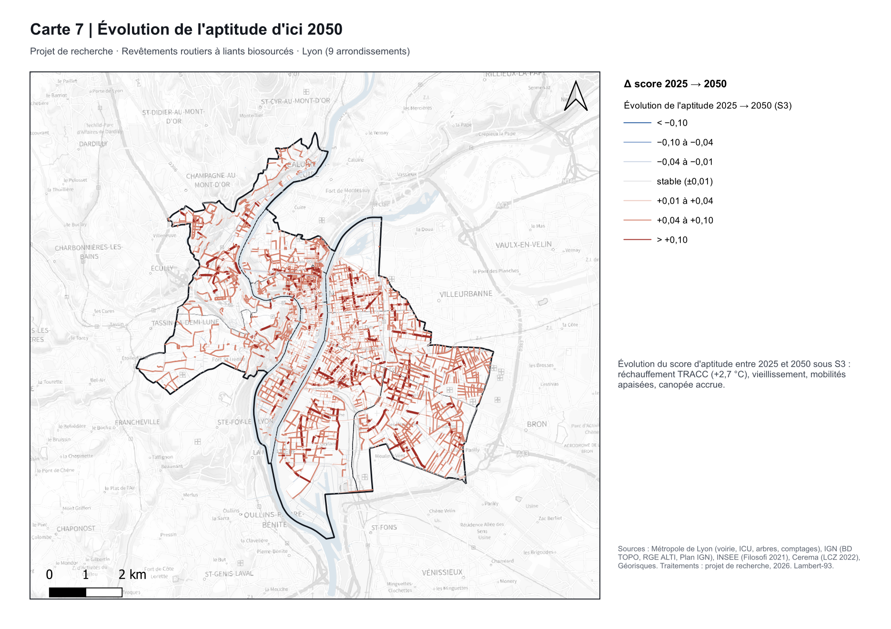</a><br><sub>7. Évolution de l'aptitude d'ici 2050</sub></td><td align="center" width="50%"><a href="05_valorisation/cartes/carte8_programme_depart.png">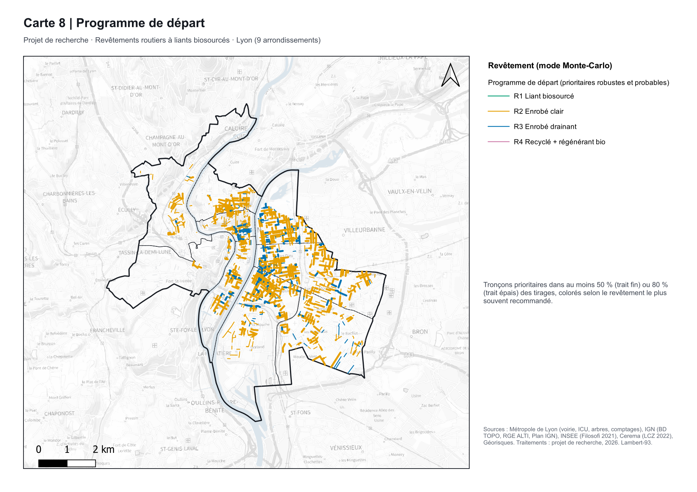</a><br><sub>8. Programme de départ</sub></td></tr>
</table>

## Ouvrir les cartes web

Les deux pages s'ouvrent par double-clic, sans installation ni serveur. Une connexion internet sert uniquement au fond de plan IGN.

### Version pour spécialistes : `webmap/index.html`

| Action | Commande |
|---|---|
| Figure suivante / précédente | → / ← (ou les touches d'une télécommande de présentation) |
| Basculer présentation / exploration | E |
| Plein écran | F |
| Fermer la fiche d'un tronçon | Échap |

- **Mode Présentation :** 10 figures (résumé graphique, puis les 5 missions), avec un parcours de 7 postes sur des rues réelles.
- **Mode Exploration :** toutes les couches, recherche d'une rue, fiche complète d'un tronçon au clic, pondération libre des enjeux recalculée en direct.

### Version grand public : `grand-public/index.html`

Un récit en 6 stations, pensé pour le téléphone :
1. Lyon a chaud ;
2. quatre façons de refaire une rue ;
3. où commencer ;
4. « Et ma rue ? » : recherche d'une rue, avec revêtement conseillé, priorité, certitude et raisons en clair ;
5. Lyon en 2050 ;
6. votre avis : sondage enregistré sur l'appareil, avec export CSV.

## Méthodologie

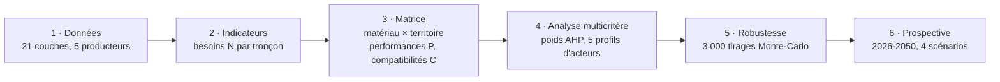

**1. Données territoriales.** 21 couches sont extraites par services web (WFS, API) ou depuis les archives officielles. Les sources sont IGN (BD TOPO, RGE ALTI), INSEE (Filosofi 2021, carreaux de 200 m), Cerema (zones climatiques locales), Métropole de Lyon (voirie, îlots de chaleur, arbres, comptages, transports) et Géorisques. Chaque couche est horodatée et inscrite au catalogue, puis normalisée dans une base en Lambert-93. L'unité d'analyse est le **tronçon de voirie** : 7 702 tronçons, dont 7 061 publics à revêtement bitumineux. Les manques sont traités et tracés, par exemple la classe de trafic poids lourds imputée ou la pente recalculée par le RGE ALTI.
→ [catalogue](01_donnees/catalogue_donnees.csv) · [dictionnaire](01_donnees/dictionnaire_donnees.md) · [rapport qualité](01_donnees/rapport_qualite.md)

**2. Indicateurs spatialisés.** Ils sont calculés par une méthode raster : ombrage des houppiers à 2 m, voisinages focaux à 5 m, rapport hauteur/largeur des rues, exposition aux îlots de chaleur, imperméabilisation, population sensible et précarité, usages. Ils sont combinés en **cinq besoins N** (0 à 1) : chaleur, santé, eau, carbone, usages.

**3. Matrice matériau-territoire.** Quatre revêtements sont étudiés :
- R1, liant biosourcé ;
- R2, enrobé clair ;
- R3, enrobé drainant ;
- R4, enrobé recyclé avec régénérant biosourcé.

Chacun reçoit des **performances P** par enjeu. Le gain carbone est annualisé sur la durée de vie. Des **compatibilités C** traduisent les contraintes du territoire : trafic poids lourds, bus, vitesse, pente, zone inondable. Le bénéfice d'un revêtement *m* sur un tronçon *s* vaut `B = C[s,m] × P[m,g] × N[s,g]`. Les valeurs matériaux sont des hypothèses (bas / central / haut) à consolider par des essais.
→ [propriétés](02_indicateurs/proprietes_materiaux.csv) · [matrice](02_indicateurs/matrice_materiau_territoire.csv)

**4. Analyse multicritère.** Des poids AHP sont établis pour cinq profils d'acteurs : équilibré, adaptation, bas-carbone, eau et sols, justice environnementale. Tous ont un ratio de cohérence inférieur à 0,01. Le score d'un tronçon est le maximum, sur les revêtements, de la somme pondérée des bénéfices. Le revêtement conseillé est celui qui l'atteint. Les classes de priorité P1 à P4 sont définies par part de surface de chaussée.
→ [poids AHP](03_amc/ahp_poids_profils.csv) · [synthèse par classe](03_amc/synthese_classes_profils.csv)

**5. Robustesse.** 3 000 tirages Monte-Carlo font varier les préférences (Dirichlet) et les paramètres matériaux (lois triangulaires). Une analyse de sensibilité un-à-un les complète. **1 145 tronçons (61 ha)** restent prioritaires dans au moins 80 % des tirages. L'albédo réel de l'enrobé clair est le paramètre le plus influent.
→ [sensibilité](03_amc/sensibilite_parametres_materiaux.csv)

**6. Prospective 2026-2050.** Les renouvellements de chaussée sont simulés tous les 15 ans environ. Le réchauffement suit la trajectoire de référence TRACC : +2,0 °C en 2030, +2,7 °C en 2050. Quatre scénarios sont comparés : tendanciel, adaptation ciblée, massification bas-carbone, transition intégrée. Les indicateurs sont le CO₂ évité (avec une fourchette d'incertitude), les habitants bénéficiaires et le ruissellement évité.
→ [hypothèses](04_prospective/scenarios.json) · [synthèse par horizon](04_prospective/synthese_horizons.csv)

Le détail complet (formules, chiffres, limites) se trouve dans le **[rapport méthodologique](05_valorisation/rapport_methodologique.md)** ; le cadrage dans la **[note de cadrage](00_cadrage/note_de_cadrage.md)**.

## Organisation du dossier

| Dossier | Contenu |
|---|---|
| `00_cadrage/` | Note de cadrage : questions de recherche, livrables, planning |
| `01_donnees/` | Catalogue, dictionnaire, rapport qualité (données brutes et base SIG régénérées par les scripts) |
| `02_indicateurs/` | Indicateurs par tronçon et grille 200 m, propriétés des matériaux, matrice matériau-territoire |
| `03_amc/` | Matrices AHP, poids par profil, résultats par tronçon, robustesse Monte-Carlo, sensibilité |
| `04_prospective/` | Scénarios, trajectoires 2026-2050, état des tronçons par scénario |
| `05_valorisation/` | Rapport méthodologique, résumé de communication, note de réunion, projet QGIS, 8 cartes A4 |
| `webmap/` | Carte d'analyse, version pour spécialistes |
| `grand-public/` | Version grand public |
| `scripts/` | Chaîne de traitement Python reproductible |

## Rejouer la chaîne

Les données brutes ne sont pas versionnées (plusieurs centaines de Mo). Le premier lancement les télécharge depuis les sources officielles :

```bash
cd scripts
python run_all.py
```

- **Relancer sans retélécharger :** `python run_all.py --sans-collecte` (environ 8 minutes).
- **Projet QGIS et cartes :** dans la console Python de QGIS, exécuter `scripts/08_projet_qgis.py`. Sans ouvrir QGIS, lancer `python-qgis-ltr.bat scripts/08b_cartes_sans_interface.py`.
- **Changer de territoire :** modifier `TERRITOIRE` dans `scripts/config.py`. Le socle IGN, INSEE, Cerema et Géorisques est national ; les couches de la Métropole de Lyon sont propres à Lyon.

Dépendances Python : geopandas, pyogrio, rasterio, scipy, pandas, numpy, requests ; playwright, pour les captures de contrôle.

## Sources et licences

Données : IGN, INSEE, Cerema et Géorisques (Licence Ouverte v2.0) ; Métropole de Lyon / SYTRAL (data.grandlyon.com, licence à vérifier jeu par jeu). Fond de plan : IGN Plan (Géoplateforme).
